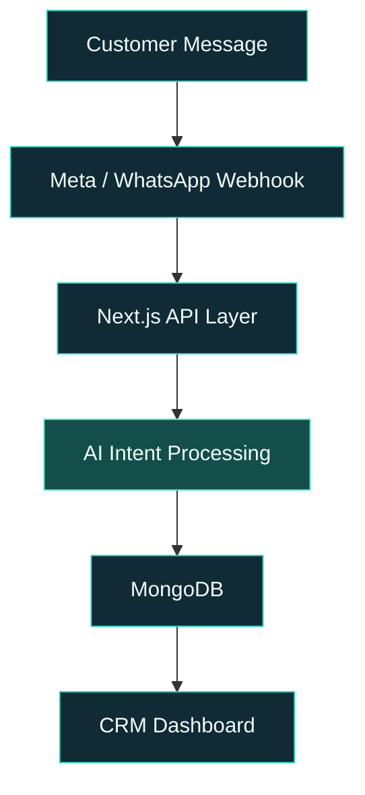
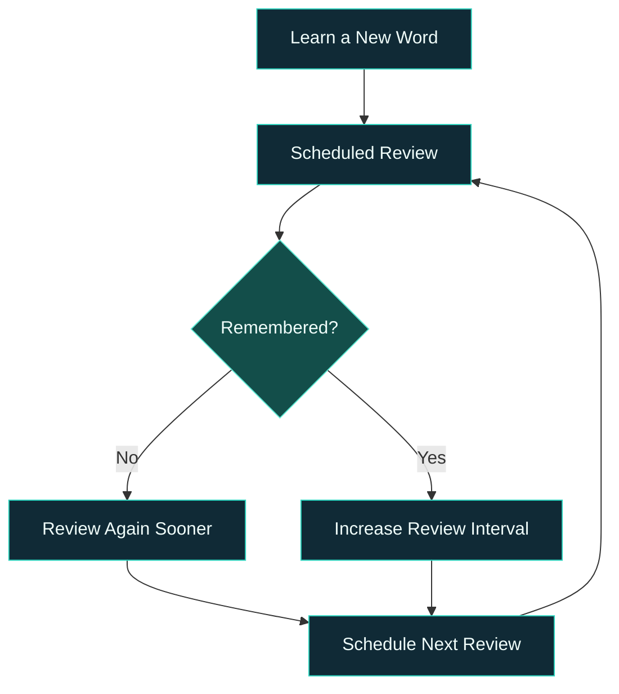

 

 

### Building useful technology. Turning ideas into products.

**CSE Undergraduate · Full-Stack Development · AI-Powered Applications**

 

  

<a href="#selected-work">Selected Work</a> &nbsp; · &nbsp;
<a href="#engineering">Engineering</a> &nbsp; · &nbsp;
<a href="#technology">Technology</a> &nbsp; · &nbsp;
<a href="#github-activity">GitHub Activity</a> &nbsp; · &nbsp;
<a href="#connect">Connect</a>

---

## 01 — Profile

I'm a Computer Science & Engineering undergraduate at **Primeasia University**, interested in building practical software at the intersection of web technologies, artificial intelligence, and education.

I enjoy turning ideas into working products — from full-stack web applications and business automation systems to accessible learning platforms.

My approach is simple:

> **Understand the problem. Design the system. Build the solution. Improve through iteration.**

Currently exploring full-stack architecture, AI integrations, API-driven systems, and progressive web applications while strengthening my foundations in software engineering.

### Areas of Interest

| Area | What I'm Exploring |
|:---|:---|
| **Full-Stack Engineering** | React, Next.js, Node.js, backend architecture |
| **AI & Automation** | AI-powered workflows, chatbots, intelligent integrations |
| **Product Engineering** | SaaS platforms, CRM systems, business tools |
| **EdTech** | Interactive learning experiences and educational PWAs |
| **System Design** | API architecture, webhooks, data flow and application structure |

---

## 02 — Selected Work

*Ideas designed to solve real problems.*

### 🇩🇪 Banglay German

**Making German language learning accessible to Bengali speakers.**

A structured German A1 learning platform designed around Bengali explanations, interactive practice, and memory-based revision.

**Inside the platform**

- 1,400+ vocabulary words across 10 learning units.
- 200+ everyday listening conversations.
- German article learning: der, die, das.
- SM-2-based spaced repetition for vocabulary revision.
- Interactive grammar, sentence-building, listening and typing exercises.
- Installable PWA with offline support.

**Product vision:** Make structured German learning more accessible to Bengali-speaking learners preparing for language examinations, Ausbildung, and higher education.

---

### 🗣️ Fluently

**A structured journey towards confident English communication.**

An interactive English-learning PWA built around a structured CEFR learning path.

**Key capabilities**

- 50 learning modules across A1, A2, B1, B2, and C1.
- Vocabulary development and memory-based revision.
- Voice-based learning practice.
- XP, achievements, level progression and daily goals.
- Personal learning dashboard and progress tracking.

**Product vision:** Turn independent language learning into a structured and engaging experience.

---

### ⚙️ Thirdwave CRM & AI Moderator

**Exploring intelligent customer communication and business automation.**

A CRM prototype exploring how AI can help businesses understand and organize incoming customer communications.

**Technical highlights**

- AI-assisted intent parsing for incoming messages.
- Meta Graph API integration.
- Webhook-based communication workflows.
- MongoDB-backed data handling.
- Next.js application architecture.

**Technology:** Next.js 14 · Node.js · MongoDB · Meta Graph API · Webhooks

---

## 03 — Engineering & System Thinking

*I am interested in understanding how software systems work beyond the user interface.*

### Thirdwave — Message Processing Architecture

The idea is to receive customer messages, process them through an API layer, identify intent using AI, and organize the resulting information inside a CRM.

### Banglay German — Spaced Repetition

The learning logic is simple: forgotten words return sooner, while successfully recalled words receive longer review intervals.

---

## 04 — Engineering Mindset

**How I approach building software**

| Principle | Approach |
|:---|:---|
| Problem First | Understand the actual user problem before choosing a technology. |
| Systems Thinking | Think about data flow, integrations, maintainability, and architecture. |
| AI as a Tool | Use AI assistants to explore solutions, accelerate implementation, and learn. |
| Iterative Development | Build, test, identify weaknesses, and improve. |
| User-Centred Design | Prioritize accessibility, clarity, and practical value. |

I use AI-assisted development tools such as ChatGPT, Gemini, Claude, and Qwen as collaborators in research, debugging, prototyping, and development.

---

## 05 — Technology

*Tools and technologies I work with and continue to explore.*

**Frontend & Application Development**

  

**Backend & Database**

  

**AI & Integrations**

  

**Development Tools & Platforms**

  

---

## 06 — GitHub Activity

 

---

## 07 — Beyond the Code

I believe good engineering is not only about writing code. It is also about identifying meaningful problems, learning continuously, and building solutions that people can actually use.

Currently interested in collaborating on:

- AI-powered applications and automation.
- Full-stack web applications.
- Educational technology and learning platforms.
- Open-source projects and innovative product ideas.

---

## 08 — Let's Connect

**Have an interesting idea, a technical challenge, or a project worth building?**

I'm open to meaningful conversations, collaboration, and opportunities to learn and contribute.

  

**Talha Belal**  
*Computer Science & Engineering · Primeasia University*

