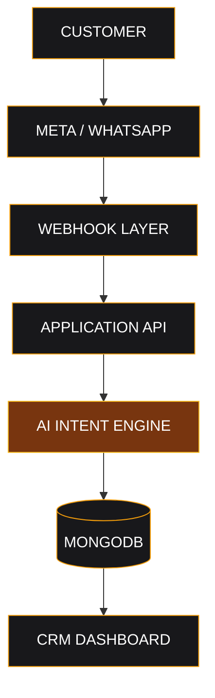
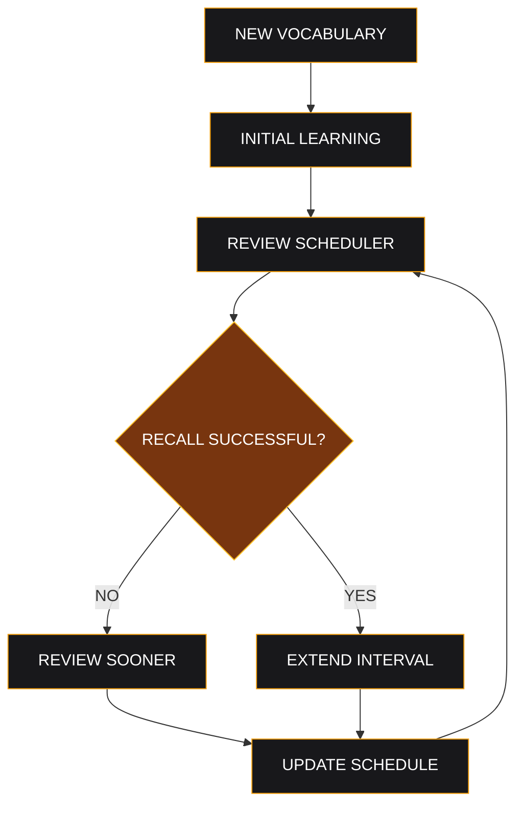

 <div align="center">


<br>

<h3>Think Beyond the Interface. Build Beyond the Ordinary.</h3>

<p>Computer Science & Engineering Undergraduate · Independent Product Builder</p>

<p>
  <a href="https://github.com/Talha0708">
    
  </a>
  <a href="https://linkedin.com/in/talha-belal-6a52371b6/">
    
  </a>
  <a href="mailto:talhabelal62@gmail.com">
    
  </a>
</p>

<br>

**OBSERVE → QUESTION → ENGINEER → BUILD → EVOLVE**

<br>

<a href="#mission">MISSION</a> &nbsp; ◈ &nbsp;
<a href="#projects">PROJECTS</a> &nbsp; ◈ &nbsp;
<a href="#blueprints">BLUEPRINTS</a> &nbsp; ◈ &nbsp;
<a href="#technology">TECHNOLOGY</a> &nbsp; ◈ &nbsp;
<a href="#activity">ACTIVITY</a> &nbsp; ◈ &nbsp;
<a href="#connect">CONNECT</a>

</div>

---

<a id="mission"></a>

# 01 / THE MISSION

### Building technology with purpose.

I'm Talha Belal, a Computer Science & Engineering undergraduate at **Primeasia University**, exploring the intersection of software engineering, artificial intelligence, and product innovation.

I believe technology should do more than look impressive. It should solve meaningful problems, simplify complex processes, and create opportunities that did not previously exist.

My work revolves around turning ideas into functional products — from intelligent business systems and automation workflows to accessible educational platforms.

**My long-term direction:**

Build meaningful technology, develop strong engineering foundations, and contribute to products that make a measurable difference.

> "Don't just learn how technology works. Learn how to use it to change what is possible."

### ENGINEERING INTERESTS

| DOMAIN | DIRECTION |
|:---|:---|
| Software Engineering | Full-stack applications and scalable architecture |
| Artificial Intelligence | AI-powered products, automation and intelligent workflows |
| Product Development | Turning real-world problems into useful software |
| Systems & Infrastructure | APIs, data processing and application design |
| Education Technology | Making quality learning tools more accessible |

---

<a id="projects"></a>

# 02 / SELECTED PROJECTS

### From concept to working software.

The best way to demonstrate engineering is to show what you build.

## 01 — BANGLAY GERMAN

**Breaking language barriers through technology.**

<a href="https://banglaygerman.vercel.app/">
  
</a>


A structured German A1 learning ecosystem designed specifically for Bengali-speaking learners.

**Core engineering features**

- Structured vocabulary system with Bangla and English translations.
- 200+ practical German listening conversations.
- Interactive der / die / das learning system.
- SM-2-based spaced repetition and revision logic.
- Grammar, sentence construction and listening exercises.
- Installable Progressive Web App with offline support.

**The problem:** Language learners often struggle with fragmented resources, complicated explanations, and inconsistent practice.

**The approach:** Combine structured learning, native-language explanations, and memory-based revision into one accessible platform.

---

## 02 — FLUENTLY

**Building a better path to language proficiency.**

<a href="https://fluently-5juy.vercel.app/">
  
</a>


An interactive English learning platform following a structured CEFR progression.

**Core engineering features**

- 50 learning modules spanning A1 to C1.
- Vocabulary development and memory-based revision.
- Voice-based learning practice.
- Gamification with XP, achievements and daily goals.
- Learning dashboard and progress tracking.
- Progressive Web App experience.

**The vision:** Make independent language learning more organized, measurable, and engaging.

---

## 03 — THIRDWAVE CRM & AI MODERATOR

**Exploring intelligent business communication.**

<a href="https://thirdwave-crm-cu8c.vercel.app/">
  
</a>


A CRM prototype exploring AI-assisted customer message processing and business automation.

**Core engineering features**

- AI-powered intent analysis for incoming messages.
- Meta Graph API integration.
- Webhook-driven message processing.
- MongoDB data management.
- Next.js API architecture.
- CRM dashboard concept.

**The vision:** Reduce repetitive communication tasks and help businesses manage customer interactions more intelligently.

---

<a id="blueprints"></a>

# 03 / SYSTEM BLUEPRINTS

### Understanding the architecture behind the products.

I believe good engineering starts with understanding how components communicate, how data moves, and how individual components form a complete system.

### Blueprint A — Intelligent CRM Processing



**Engineering concept:** Incoming messages → API processing → AI-assisted intent analysis → persistent storage → CRM interface.

### Blueprint B — Intelligent Vocabulary Revision



**Engineering concept:** Learning should be adaptive. Review frequency changes based on recall performance.

---

# 04 / ENGINEERING PHILOSOPHY

### First principles. Clear thinking. Practical execution.

| PRINCIPLE | HOW I APPROACH IT |
|:---|:---|
| First Principles | Break complex problems into smaller fundamentals. |
| Systems Thinking | Understand the entire system, not just individual features. |
| Experimentation | Explore unconventional approaches and test assumptions. |
| Continuous Learning | Improve through implementation, feedback and iteration. |
| Real-World Impact | Prioritize useful outcomes over unnecessary complexity. |

### My Development Loop

```text
        PROBLEM
           |
           v
     RESEARCH & THINK
           |
           v
      SYSTEM DESIGN
           |
           v
        BUILD
           |
           v
    TEST & EVALUATE
           |
           v
        ITERATE
           |
           └──────────> IMPROVE
```

I use AI-assisted development tools including ChatGPT, Gemini, Claude, and Qwen to support research, debugging, experimentation, and implementation.

AI accelerates the process. Understanding the system remains essential.

---

<a id="technology"></a>

# 05 / TECHNOLOGY & TOOLS

### My current engineering ecosystem.

**Frontend Engineering**

<p>
  
</p>

**Backend & Data**

<p>
  
</p>

**AI & Integrations**

<p>
  
  <br>
  
  
  
  
</p>

**Tools & Platforms**

<p>
  
</p>

*This represents technologies I work with and continue to explore, not a claim of mastery in every tool.*

---

<a id="activity"></a>

# 06 / ENGINEERING ACTIVITY

### The journey is ongoing.

<div align="center">


<br><br>


</div>

---

# 07 / THE ROAD AHEAD

### Bigger problems. Better solutions.

My long-term interests extend beyond individual applications.

I want to explore:

- Intelligent software systems powered by AI.
- Automation that makes businesses more efficient.
- Educational technology with meaningful social impact.
- Scalable product architecture and reliable infrastructure.
- Experimental engineering and new product concepts.

**Not interested in building for attention. Interested in building things that matter.**

---

<a id="connect"></a>

# 08 / INITIATE CONTACT

<div align="center">

### Have a problem worth solving?

I'm open to connecting with developers, engineers, founders, researchers, and builders who enjoy creating meaningful technology.

<br>

<a href="mailto:talhabelal62@gmail.com">
  
</a>

<a href="https://linkedin.com/in/talha-belal-6a52371b6/">
  
</a>

<br><br>

**TALHA BELAL**

`COMPUTER SCIENCE & ENGINEERING`

<sub>THINK DEEPLY. BUILD INTELLIGENTLY. KEEP EVOLVING.</sub>

<br>


</div>
