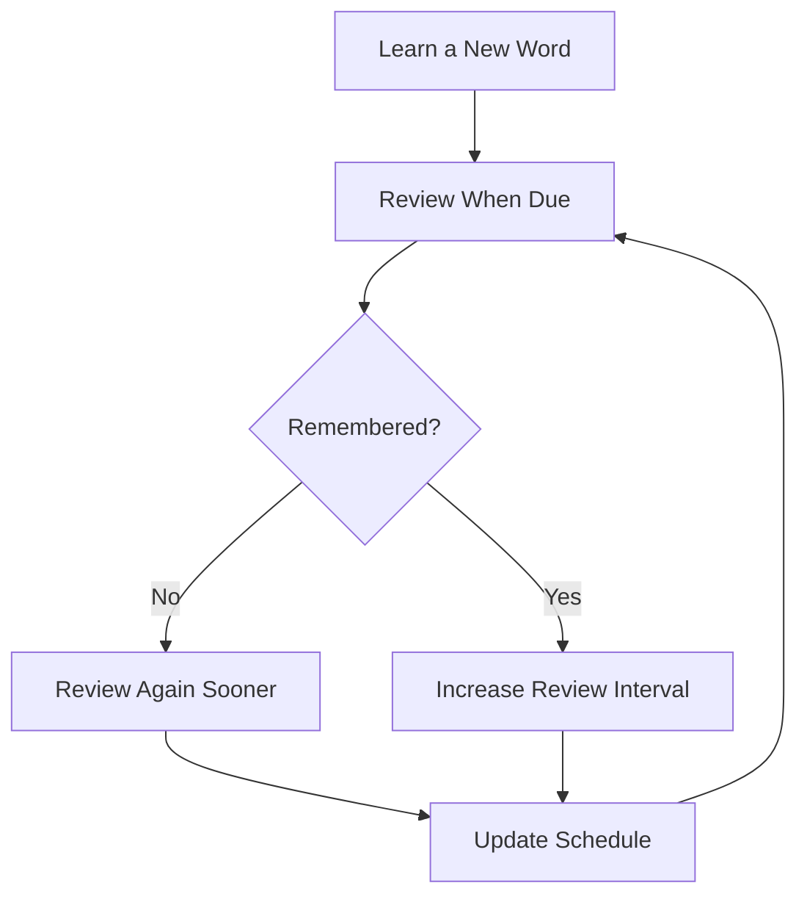
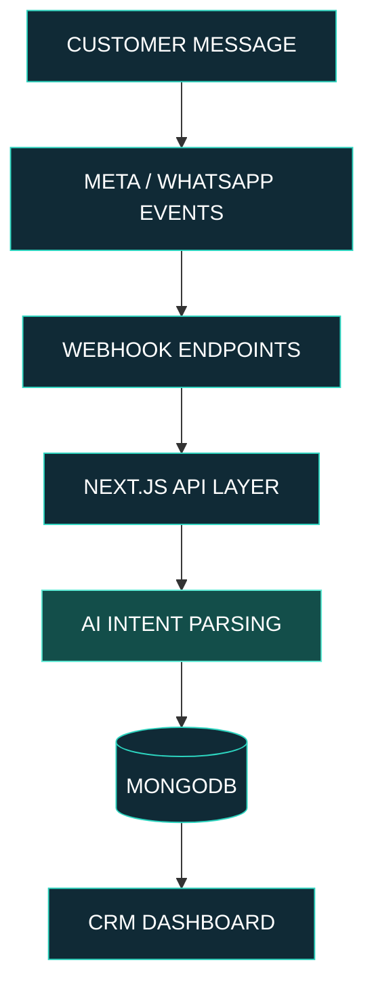
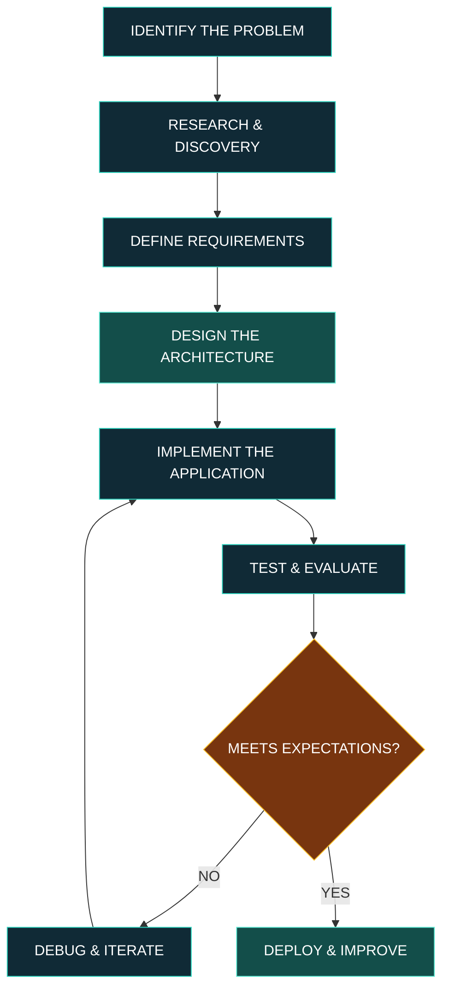

 

 

### CSE Undergraduate | Exploring Full-Stack Development | AI & Emerging Technologies

*Turning ideas into functional products through software, experimentation, and continuous learning.*

 

  

**THINK DEEPLY. BUILD INTELLIGENTLY. KEEP EVOLVING.**

 

<a href="#about">ABOUT</a> &nbsp;·&nbsp;
<a href="#projects">PROJECTS</a> &nbsp;·&nbsp;
<a href="#architecture">ARCHITECTURE</a> &nbsp;·&nbsp;
<a href="#technology">TECHNOLOGY</a> &nbsp;·&nbsp;
<a href="#philosophy">PHILOSOPHY</a> &nbsp;·&nbsp;
<a href="#contact">CONTACT</a>

---

# 01 — About Me

### Curiosity drives innovation. Engineering turns ideas into reality.

Hello! I'm **Talha Belal**, a Computer Science and Engineering undergraduate at **Primeasia University**, Bangladesh.

I'm interested in exploring how modern software engineering and artificial intelligence can be combined to create practical, accessible, and meaningful digital products.

Rather than focusing exclusively on writing code, I enjoy understanding the problems behind a product, exploring possible solutions, designing application structures, and turning concepts into working applications.

My current interests include:

- **Full-Stack Development:** Building modern web applications with React, Next.js, Node.js, and MongoDB.
- **Artificial Intelligence:** Exploring AI-powered applications, intelligent workflows, chatbots, and automation.
- **Product Engineering:** Developing practical platforms, business tools, and software solutions.
- **Educational Technology:** Creating accessible and interactive learning experiences.
- **Emerging Technologies:** Exploring new ideas, experimenting with technologies, and continuously expanding my engineering knowledge.

### What I'm Currently Focused On

| Focus | Direction |
|---|---|
| Building | Full-stack applications and independent software products |
| Exploring | AI integration, automation, and intelligent applications |
| Improving | Next.js, backend development, API architecture, and database design |
| Experimenting | Progressive Web Apps and AI-assisted product development |
| Learning | System design, LLM workflows, webhooks, and software engineering principles |

My goal is to develop strong engineering foundations while building technology that solves real-world problems.

---

# 02 — Featured Projects

*Selected products and engineering experiments.*

I enjoy building projects that combine technical exploration with practical use cases. These projects represent my current interests in educational technology, software development, and AI-powered business solutions.

## 01. 🇩🇪 Banglay German

EDTECH · LANGUAGE LEARNING · PROGRESSIVE WEB APP

### Making German language learning accessible to Bengali speakers.

**Banglay German** is a Bengali-first German language learning platform designed to help Bengali speakers understand, practice, and improve their German language skills through a structured learning experience.

Learning German can be challenging, especially for beginners who struggle with grammatical articles, vocabulary memorization, sentence construction, pronunciation, and finding structured learning resources in their native language.

The goal of this project is to bring essential German learning materials and interactive practice tools together in one accessible platform.

### Platform Overview

| Component | Available Content |
|---|---|
| Vocabulary Library | 1,400+ German vocabulary words |
| Vocabulary Organization | 10 structured learning units |
| Listening Practice | 200+ everyday German conversations |
| Grammar | Articles, sentence construction, and verb conjugation |
| Smart Revision | SM-2-based spaced repetition |
| Learning Approach | German with Bangla and English explanations |
| Platform | Installable Progressive Web App |

### Core Features

**01. Structured German Vocabulary**

A categorized vocabulary library designed to make learning German words more organized and manageable.

- 1,400+ vocabulary words across 10 units.
- German vocabulary with Bangla and English meanings.
- Example sentences for contextual understanding.
- Organized learning categories.
- Vocabulary revision and practice.

The objective is not just to memorize individual words, but to understand how they are used in everyday German communication.

**02. German Listening Practice**

Listening is an essential part of language acquisition. The platform includes 200+ everyday German listening conversations.

- Practical everyday conversations.
- Audio-based listening exercises.
- Continuous autoplay support.
- Repeated listening for improved comprehension.
- Listening-focused practice activities.

This helps learners gradually become familiar with spoken German, sentence structures, and everyday expressions.

**03. Understanding der, die, and das**

One of the most confusing aspects of German for beginners is grammatical gender.

The platform includes a color-coded article learning system for:

- **der** — Masculine
- **die** — Feminine
- **das** — Neuter

The visual distinction helps learners recognize and remember German grammatical articles more effectively.

**04. Intelligent Vocabulary Revision**

Banglay German incorporates an SM-2-based spaced repetition approach to vocabulary revision.

Instead of reviewing every word at the same frequency, the system follows a memory-based revision concept.

- Words that are difficult to recall can return sooner.
- Successfully recalled words can receive longer review intervals.
- Repeated revision helps reinforce long-term vocabulary retention.
- Scheduled review makes learning more structured.

<b>How the vocabulary revision system works</b>

The SM-2 approach adjusts review intervals according to recall performance, helping learners focus on words they find difficult.

**05. Interactive Practice Lab**

The Practice Lab combines different types of exercises to make learning more interactive.

| Practice Module | Purpose |
|---|---|
| Sentence Building | Understand German sentence structure |
| Verb Conjugation | Practice German verb forms |
| Article Quiz | Identify the correct German article |
| Meaning Quiz | Test vocabulary comprehension |
| Listening Challenge | Improve listening skills |
| Typing Challenge | Practice accurate written responses |

**06. Installable Progressive Web App**

Banglay German is designed as an installable PWA.

- Add to Home Screen support.
- Offline support.
- App-like experience on compatible devices.
- Accessible through a web browser.
- No traditional APK installation required.

### Educational Goal

The platform is particularly relevant for Bengali-speaking beginners preparing for German A1 learning and looking for structured preparation support for future language examinations, Ausbildung, or higher education.

**The bigger idea:** Make German language learning more accessible to Bengali speakers by bringing structured content, understandable explanations, and interactive practice into one place.

Project type: Independent EdTech project · Live web application

---

## 02. 🗣️ Fluently

EDTECH · ENGLISH LEARNING · CEFR · PROGRESSIVE WEB APP

### A structured pathway to confident English communication.

**Fluently** is an interactive English learning Progressive Web App built around a structured learning path following the Common European Framework of Reference for Languages (CEFR).

The platform is designed to organize English learning into progressive levels, helping learners move from beginner-level foundations toward more advanced communication skills.

### Learning Framework

The platform includes 50 master learning modules across five CEFR levels.

<b>Explore the CEFR learning structure</b>

| Level | Learning Stage |
|---|---|
| A1 | Beginner |
| A2 | Elementary |
| B1 | Intermediate |
| B2 | Upper Intermediate |
| C1 | Advanced |

A progressive learning structure allows learners to develop their skills through increasingly challenging material.

### Core Features

**01. Structured Learning Curriculum**

- 50 master modules across A1, A2, B1, B2, and C1.
- Organized learning progression.
- Level-based educational content.
- A more structured alternative to random vocabulary practice.

**02. Vocabulary Development**

Vocabulary is an important foundation of language learning.

Fluently provides vocabulary-focused learning activities designed to support word recognition, understanding, and revision.

**03. Memory-Based Revision**

Learning does not end after completing a lesson. Revision plays an important role in retaining information.

The platform includes memory-based revision features to help learners revisit previously learned material.

**04. Voice-Based Practice**

Voice-oriented learning practice helps learners engage with spoken English and develop their communication skills.

**05. Gamification & Motivation**

Fluently incorporates motivational learning mechanics:

- XP and experience-based progression.
- Achievements and rewards.
- Daily goals.
- Learning challenges.
- Level progression.

**06. Interactive Learning Dashboard**

The dashboard provides a centralized learning experience, giving learners a place to interact with learning activities and track their progress.

### Product Vision

Fluently aims to make English learning more structured, engaging, and accessible through a single digital learning platform.

**The bigger idea:** Combine a progressive curriculum with interactive exercises, revision, and motivational features to encourage consistent learning.

Project type: Independent EdTech project · Live PWA

---

## 03. ⚙️ Thirdwave CRM & AI Moderator

BUSINESS SOFTWARE · CRM · ARTIFICIAL INTELLIGENCE · API INTEGRATION

### Exploring intelligent customer communication and business automation.

**Thirdwave CRM & AI Moderator** is a personal software project exploring how artificial intelligence and API-driven communication systems can help businesses organize customer interactions.

For many businesses, customer conversations arrive through different communication channels. Managing incoming messages, understanding customer intent, and keeping communication organized can become repetitive and difficult.

Thirdwave explores a centralized CRM approach where incoming customer messages can be processed, analyzed, and organized through an application workflow.

### Project Objectives

- Explore centralized customer communication management.
- Integrate external messaging services through APIs and webhooks.
- Use AI-assisted intent parsing to understand incoming messages.
- Organize processed information through a CRM-oriented application.
- Explore how automation can reduce repetitive business workflows.

### System Components

**01. Meta Graph API Integration**

The project explores Meta Graph API integration as a communication entry point.

This integration provides the foundation for receiving and working with supported Meta platform events.

**02. WhatsApp Webhook Workflow**

Webhook-based communication is an important part of the project architecture.

Incoming webhook events can be received by the application's backend, allowing the system to process communication events through a structured API workflow.

**03. AI-Powered Intent Parsing**

One of the key areas of exploration is AI-based intent parsing.

Rather than treating every incoming customer message as plain text, the project explores interpreting the underlying intent of a message.

Possible intent categories include:

- Product-related inquiries.
- Pricing questions.
- Availability questions.
- Order-related communication.
- General customer support inquiries.

These are example classification categories rather than a claim that every category has been implemented.

**04. Backend API Layer**

The backend application layer connects external communication events with the AI processing and data management components.

The project uses Next.js API routes and Node.js-based application development concepts.

**05. MongoDB Data Layer**

MongoDB is used as the database technology in the project.

It provides the data storage foundation for the CRM application and its communication-related information.

**06. CRM Dashboard**

The dashboard represents the central interface for the CRM experience.

Its purpose is to present organized business communication through an application interface rather than requiring users to work directly with raw webhook events.

### System Architecture

### Technology Behind Thirdwave

| Layer | Technology |
|---|---|
| Application Framework | Next.js 14 |
| Backend | Node.js |
| Database | MongoDB |
| External Integration | Meta Graph API |
| Communication Events | Webhooks |
| AI Component | AI-assisted intent parsing |
| Deployment | Vercel |

### Engineering Concepts Explored

Through this project, I'm exploring:

- Event-driven application workflows.
- API-based system integration.
- AI-assisted message understanding.
- Backend application architecture.
- Database-oriented application design.
- Communication between external services and internal applications.

### Future Engineering Direction

Some possible areas for further development include:

- More advanced customer intent classification.
- Lead organization and customer categorization.
- Conversation management and workflow automation.
- Improved CRM analytics and reporting.
- More sophisticated AI-assisted customer support.

These are future development directions, not claims about currently available features.

**The bigger idea:** Explore how AI can move beyond standalone chatbots and become part of practical business software.

Project type: Personal full-stack CRM prototype · Live project preview

---

## Project Portfolio at a Glance

| Project | Domain | Primary Focus |
|---|---|---|
| Banglay German | EdTech | German learning for Bengali speakers |
| Fluently | EdTech | CEFR-based English learning |
| Thirdwave CRM | Business Software | AI-assisted customer communication |

---

# 03 — Architecture & Engineering

### Understanding systems, not just interfaces.

I enjoy understanding how different components of an application work together.

A functional product is not just a collection of frontend components. It involves application architecture, data management, API communication, business logic, and a consistent user experience.

### Engineering Workflow

### Concepts I'm Exploring

| Area | Concepts |
|---|---|
| Frontend Architecture | Component-based design, reusable interfaces |
| Backend Architecture | API routes, request handling, business logic |
| Data Management | Document databases, data organization |
| AI Integration | Intent parsing, LLM-powered application features |
| System Integration | REST APIs, webhooks, external services |
| Deployment | Production builds and cloud application deployment |
| PWA Engineering | Installability and offline application experiences |

---

# 04 — Technology Stack

### Technologies I work with and continue to explore.

**Frontend & Web Development**

  

**Backend & Database**

  

**AI & API Integrations**

  

  
  
  
  

**Tools & Platforms**

  

**AI-Assisted Development Tools**

ChatGPT · Google Gemini · Claude · Qwen

*My technology stack reflects the tools I use and explore while developing projects. I believe in continuously improving practical engineering ability rather than claiming mastery of every technology.*

---

# 05 — Development Philosophy

### How I think about building technology.

**01. First Principles Thinking**

Understand the fundamentals of a problem before choosing a solution. Break complicated challenges into smaller, understandable components.

**02. Systems Over Isolated Features**

Think about how frontend, backend, databases, APIs, and external services connect to form a complete application.

**03. AI as an Engineering Tool**

Use AI assistants to support research, debugging, experimentation, and implementation while continuing to develop independent technical understanding.

**04. Build, Test, Improve**

A working prototype is a starting point. Testing, evaluating limitations, and improving the implementation are essential parts of development.

**05. Problem-Oriented Development**

Choose technologies based on the problem being solved, not simply because a particular framework is popular.

### My Development Cycle

`IDEA → RESEARCH → ARCHITECTURE → DEVELOPMENT → TESTING → ITERATION`

---

# 06 — Current Learning & Exploration

I'm continuously working on improving my understanding of software engineering and modern development practices.

| Learning Area | Current Direction |
|---|---|
| Full-Stack Development | Advanced Next.js and application architecture |
| Backend Engineering | APIs, webhooks, and secure backend routing |
| Artificial Intelligence | LLM integration and intelligent workflows |
| Database Engineering | Data modeling and application data management |
| Software Design | Maintainability, modularity, and system design |

I also enjoy experimenting with AI-powered development workflows and exploring how emerging technologies can be applied to practical software products.

---

# 07 — GitHub Activity

### Consistency through building and learning.

  

 

<!-- Enable the snake workflow in your repository before using these images. -->

---

# 08 — Beyond the Code

### Curiosity has no boundaries.

Technology is constantly evolving. I enjoy exploring ideas beyond my current skill set, learning new concepts, and understanding how emerging technologies can create new possibilities.

Some areas that interest me:

- Artificial intelligence and intelligent agents.
- Innovative software products and SaaS platforms.
- Robotics and automation.
- Educational technology and digital accessibility.
- Open-source development and collaborative engineering.
- Experimental solutions to real-world problems.

I believe meaningful progress comes from curiosity, experimentation, consistency, and the willingness to learn from failure.

---

# 09 — Let's Connect

### Have an interesting idea or a problem worth solving?

I'm open to meaningful conversations, technical discussions, project collaborations, and opportunities to learn from other developers and engineers.

Whether it's software engineering, AI, EdTech, or an unconventional product idea, I'd be glad to connect.

  

**TALHA BELAL**

*CSE Undergraduate · Primeasia University*

 

**THINK DEEPLY. BUILD INTELLIGENTLY. KEEP EVOLVING.**

